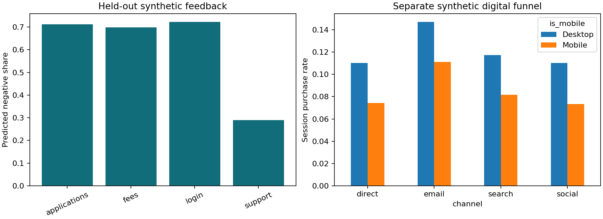

# Voice of Customer NLP and Digital Funnel Diagnostics

> Independent portfolio simulation. All data and numerical results are synthetic. No company data, proprietary code or internal methods are included.

## Business question

A fictional financial-services provider wants to route customer feedback into actionable themes. A separate fictional commerce funnel provides digital-measurement practice.

This demonstrates TF-IDF, topic and sentiment classification, exploratory NMF, held-out phrase-family evaluation, human-review routing and session-grain funnel SQL. It deliberately keeps feedback and website populations separate.

## Quick start

Python 3.12 is recommended (the version used for verification). Run from this repository's directory:

```bash
python -m venv .venv
source .venv/bin/activate
pip install -r requirements.txt
python run.py
python -m unittest discover -s tests
```

On Windows use `.venv\Scripts\activate` to activate the environment. Data, analysis outputs and charts are already included so you can inspect the case without installing dependencies. Running the script recreates them with a fixed seed. Internet is needed only to install dependencies. For tightly reproducible environments see `VERIFICATION.md` for the versions used in the supplied run; `requirements.txt` allows compatible versions.

## Design and methods

- 1,800 synthetic feedback records across five business topics, three sentiments and chat/review/social channels. No real customer language or personal information.
- Reserve one of four phrase families for testing; train vectorizers and classifiers on the other three. No exact phrase family crosses the split.
- Separate TF-IDF + logistic classifiers for topic and sentiment, with macro F1 and classification reports.
- Unsupervised NMF on training text reports exploratory top words; sentiment can dominate these groups.
- Dashboard uses held-out feedback only; route low-confidence predictions to review with an illustrative 0.65 threshold.
- 6,000 separate synthetic sessions; nested product/cart/purchase flags, SQL funnel rates by channel and device. Descriptive comparison only.

## Results and interpretation

Read [the generated business memo](outputs/decision_memo.md), [machine-readable metrics](outputs/summary.json) and [data dictionary](DATA_DICTIONARY.md). All numerical outcomes are from the synthetic environment. Report intervals and limitations alongside estimates.



## Repository map

- `run.py`: data generation, estimation, diagnostics, SQL execution and reporting.
- `data/`: generated sample data; primary table `feedback.csv`.
- `sql/`: executable SQLite metric queries, also useful as warehouse query examples.
- `notebooks/walkthrough.ipynb`: guided analysis and reflection; Jupyter is optional and is not a pipeline dependency.
- `outputs/`: CSV tables, summary JSON, decision memo, chart and generated SQLite database.
- `tests/`: data and methodological invariant checks.
- `.github/workflows/verify.yml`: rerun and checks on GitHub pushes/PRs.
- `DATA_POLICY.md`: provenance and publication boundaries.
